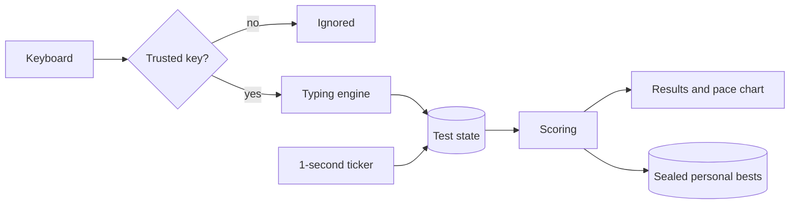
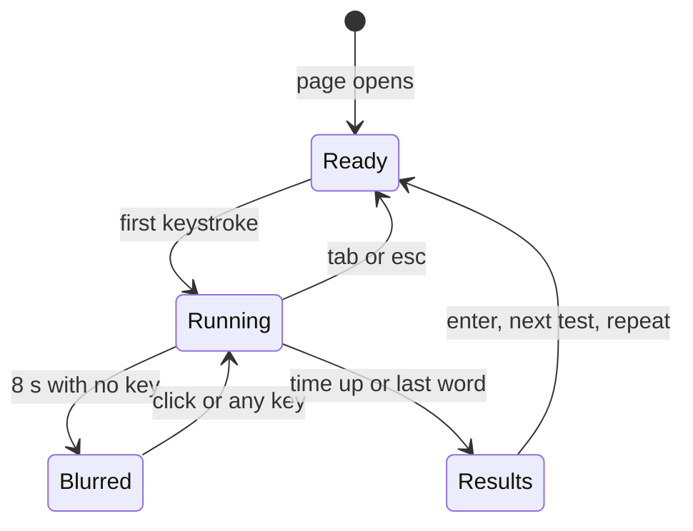
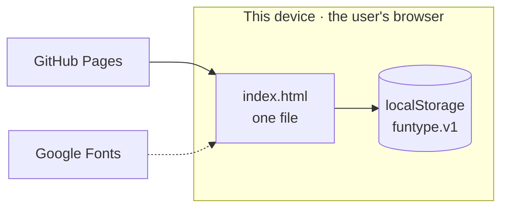

# FunType — Project Proposal

**Typing-Speed Trainer**

14 October 2026 · Kaon · Revision 4

*A formatted edition of this proposal, with a cover page, contents and diagrams, sits beside it as [FunType-Project-Proposal.docx](FunType-Project-Proposal.docx) and [FunType-Project-Proposal.pdf](FunType-Project-Proposal.pdf). This Markdown file is the source; the two are generated from it.*

## Executive summary

FunType is a browser-based typing-speed trainer: one HTML file, four drill modes, no server, no account and nothing to install. A working build is already live at [kaonhew02.github.io/FunType](https://kaonhew02.github.io/FunType/) — 929 lines of hand-written HTML, CSS and JavaScript in a single 46 KB file, with no build step and no libraries. As of 23 September 2026 it also ignores scripted keystrokes and pasted text, seals its saved records against hand-editing, and puts back any score edited on screen.

The product exists because the trainers people already use either score generously or want an account, and often both — and a typing score is only worth practising against if the typist can trust how it was worked out.

|  |  |
| --- | --- |
| Product | FunType — *Train the hands, the words follow.* |
| Category | Typing-speed trainer (web application) |
| Primary user | People who type for a living — developers, writers, support staff — and students practising for speed |
| Delivered | 4 drill modes, 2 difficulty toggles, a five-part measurement model, a pace chart, per-configuration personal bests, 8 themes |
| Stack | One static HTML file on GitHub Pages · vanilla JavaScript · the browser's `localStorage` |
| Security | Trusted-keystroke check · paste and drop blocked · sealed save · on-screen score guard · 400 WPM cap |
| Dependencies | No npm packages, no build step, no framework, no API keys; one Google Fonts stylesheet |
| Running cost | RM 0/month — hosting is GitHub Pages and storage is the user's own browser |
| Effort to date | 6 commits, 11 Sep 2026 – 14 Oct 2026 |
| Proposed next phase | 10 weeks: freeze and test the measurement model, triple the content, add history, build per-key coaching |

**The ask.** Approval to run the ten-week Phase 4 in [Project plan and timeline](#project-plan-and-timeline) at the resourcing set out in [Resources and budget](#resources-and-budget) — one developer, part-time (about 50 hours), and RM 0 committed.

## Background and problem statement

The problem is not that typing trainers do not exist — it is that most of them measure in a way that rewards the wrong habit, or put an account between the user and the first keystroke. A typing score is a promise about skill. If the arithmetic behind it is generous, the typist practises toward a number rather than toward accuracy.

FunType began on 11 September 2026 as a single-file drill page. The scope question arrived early: a speed figure is worthless without a definition, and a definition is worthless if the stored best was produced under a different one. The project therefore treats the measurement model — not the modes or the themes — as the product.

### What the alternatives get wrong

| Option | What it costs the user |
| --- | --- |
| Gamified school trainers | Gross WPM counts every keystroke, right or wrong, so the score climbs as the typist gets sloppier; badges and class accounts come first |
| Platform-style trainers | A login, leaderboards and several menus before the first keystroke; results kept on someone else's server |
| Trainers that charge for backspace | Fixing a mistake lowers the score, which teaches people to leave mistakes in |
| One "best" across every setting | Turning punctuation on drops WPM, so the record shows which setting was easiest, not how fast the person types |
| A stopwatch and a paragraph | Private and free, but no per-character accuracy, no pace curve and no record |

### The developer gap

Most trainers drill English prose. A working developer's speed ceiling is not on prose — it is on brackets, quotes, semicolons, `=>` and the shift key. A trainer that never shows `data.filter(r => r.active)` never trains the characters that actually slow a programmer down.

### The design flaw underneath all of it

Most trainers keep one headline number and change what feeds it without saying so. When the definition shifts — gross to net, counting spaces or not, charging backspace or not — every stored best stops being comparable with every new run, and there is no way to recompute it because the keystrokes were never kept. FunType's founding constraint, *define the number in public and never change it silently*, exists to make that class of error impossible.

## Proposed solution

FunType is one page that measures typing the way a sceptic would, and refuses everything else. There is no account to create, nothing to install and nothing sent anywhere.

### From keystroke to personal best

Every keystroke passes one gate, changes one piece of state, and is scored from that state alone. Nothing downstream writes back upstream: the results screen and the records bar only ever display what scoring produced.



Scripted keys stop at the gate. Pasted text never reaches the engine at all. A best is written only by scoring, only when it beats the stored figure, and only when it is humanly possible.

### The measurement model

Five figures, each with one published formula. They are implemented exactly as stated here and in the repository README.

**Net WPM — the headline.** Only correct characters count. A correctly typed word also earns its trailing space; a word left wrong does not.

```
net wpm = correct characters ÷ 5 ÷ minutes
```

**Raw WPM — shown beside it, on purpose.** Every character typed, right or wrong, over the same clock. The gap between raw and net is the signature of typing faster than accuracy can support, which is the most common way to plateau.

```
raw wpm = all characters typed ÷ 5 ÷ minutes
```

**Accuracy — backspaces are free.** A backspace is neither a keystroke nor an error, so correcting a mistake never costs score.

```
accuracy = correct keystrokes ÷ (correct + wrong keystrokes) × 100
```

**Consistency — how even the pace was.** Each second the engine records characters typed that second × 12, a WPM-equivalent; consistency is how little that series varies, clamped to 0–100.

```
consistency = 100 × (1 − standard deviation ÷ mean)
```

**The character breakdown** — reported as `correct / wrong / extra / missed`:

| Class | Means | What it tells the typist |
| --- | --- | --- |
| **correct** | The right character in the right place | — |
| **wrong** | A wrong character in a position | Finger accuracy |
| **extra** | Typed past the end of a word | Not reading ahead |
| **missed** | Space pressed before the word was finished | Anticipating the word boundary |

Splitting *extra* from *missed* matters because they are opposite faults with opposite fixes.

### One record per exact configuration

A personal best is stored against the exact settings that produced it. The key joins mode, length and toggles — `time-30`, `words-25-p`, `time-60-p-n`, `code-sql` — so switching punctuation on starts a fresh record rather than polluting the old one. A best is claimed on net WPM; accuracy and the date are stored beside it for context.

### What the user gets that they did not have

- **A number they can trust.** Net WPM as the headline, raw beside it, and every formula published.
- **An instant start.** The words are on screen when the page opens, and the first keystroke starts the clock. No login, no splash, no setup.
- **Drills for real work.** A `code` mode on real JavaScript, Python and SQL, where a developer's speed actually sits.
- **Privacy by construction.** Records stay in one browser on one machine. There is no account, no analytics and nothing to delete later.
- **A file you can copy.** One HTML file that runs from a web host, a USB drive or an email attachment, with no toolchain to rot.

## Objectives and success criteria

The project succeeds if a typist can practise on FunType daily for a month and never have reason to doubt a score. Everything below is a test, not an aspiration.

| # | Objective | Measure | Threshold | Status |
| --- | --- | --- | --- | --- |
| O1 | The headline counts only correct work | Wrong characters counted in net WPM | 0 | Met |
| O2 | Correcting a mistake is never punished | Backspaces counted as keystrokes or errors | 0 | Met |
| O3 | Practice starts instantly | Time from page load to a counted keystroke; screens before it | ≤ 2 s; 0 screens | Met |
| O4 | Records stay comparable | Personal bests shared between different settings | 0 | Met |
| O5 | The app runs with nothing installed | npm packages, build steps, frameworks, API keys | 0 of each | Met |
| O6 | Nothing about the user leaves the device | Requests carrying typing data or identifiers | 0 | Met |
| O7 | Runs anywhere, unchanged | Opens from `file://`, a USB drive and GitHub Pages | 3 of 3 | Met |
| O8 | A script cannot type | Synthetic key or input events accepted | 0 | Met (23 Sep 2026) |
| O9 | A hand-edited save cannot hold a record | Edited saves accepted on load | 0 | Met (23 Sep 2026) |
| O10 | Impossible runs never become records | Personal bests above 400 WPM | 0 | Met (23 Sep 2026) |
| O11 | Motion can be switched off | Animations running under reduced-motion settings | 0 | Met |
| O12 | Every theme is readable | Themes checked for legibility and a correct mark | 8 of 8 | 4 of 8 — dusk, daylight, bubblegum, terminal |
| O13 | The scoring is proven, not trusted | Automated assertions per metric | ≥ 1 per metric | **Not met** — no automated tests yet |
| O14 | The content cannot be memorised quickly | Unique words in the drill pool | ≥ 1,000 | **Not met** — 288 today |

### What "done" means for Phase 4

O13 and O14 are the two open rows that matter, and they come first in Phase 4 because every later feature — history, coaching — is only as good as the numbers underneath it. O12 is a visual pass that closes in the release week. Phase 4 then adds one new objective: a results screen that names the typist's weakest keys and drills them.

### Explicit non-objectives

These are refused on purpose, and each refusal has a reason that should survive a change of mind:

- **No accounts or cloud sync.** Both need a server, and both move the user's records off the device.
- **No global leaderboard.** A leaderboard is only as honest as the server that re-checks each run. FunType has no server, so any leaderboard it showed would be the easiest thing in the product to fake.
- **No lessons or curriculum.** Guided home-row teaching is a different product with a different user.
- **No analytics or telemetry.** The privacy claim is only true if there is nothing to switch off.
- **No gross WPM headline, and no charge for backspace.** Both are exactly the habits the product exists to correct.

## Target users and personas

The target user is one adult who already types every day and wants to get measurably faster — on a physical keyboard, at a desk. Not a classroom, not a child learning the home row, and not someone looking for a game.

| Persona | Situation | What they need | Lives in |
| --- | --- | --- | --- |
| **Aiman, 27 — the developer** | Writes TypeScript all day; about 70 WPM on prose, much slower on brackets, arrows and quotes | Drills on real code, and a raw-versus-net gap that shows where the errors are | `code`, `time 60` with punctuation |
| **Mei Ling, 31 — the support agent** | Answers chat tickets all shift; a typo in a reply costs more than a slow reply | Accuracy that does not punish correcting, and a calm screen | `words 50`, `text medium` |
| **Hafiz, 20 — the student** | Practises on a shared college computer and will not make an account there | An instant start, nothing to sign up for, records that stay in that browser | `time 30`, `time 60` |
| **Priya, 35 — the writer** | Drafts long-form; bursts on familiar words and stalls on new ones | A consistency score that shows the stalls, and long passages | `text long`, `time 120` |

One person is often two of these at once, which is why they are one trainer and not four.

### Jobs to be done

- *When I have ten minutes between tasks, I want to start typing immediately, so that I actually practise instead of setting up.*
- *When my score drops, I want to see whether it was speed or accuracy, so that I know what to fix.*
- *When I switch on punctuation, I want a separate record, so that a harder drill does not look like a bad day.*
- *When I write code for a living, I want to drill the symbols, so that my working speed improves and not just my prose speed.*
- *When I use a shared computer, I want no account, so that nothing about me is left on a server.*

### Who this is not for

Schools needing class management, assignments and teacher reports; beginners who need guided home-row lessons; and anyone who wants to race strangers on a public leaderboard. The last is a real and common want, and [Future roadmap](#future-roadmap) states plainly what it would take to meet it honestly.

## Scope — module breakdown

Seven modules live inside the one file, each named by the verb it serves. All seven are delivered. Phase 4 deepens M1 and M5 and adds an eighth, M8 Coach.

| # | Verb | Module | Main code | Status |
| --- | --- | --- | --- | --- |
| M1 | Drill | Modes and content | `WORDS`, `TEXTS`, `CODE`, `buildWords`, `decorate` | Delivered |
| M2 | Type | Typing engine | `typeChar`, `commitWord`, `backspace`, `moveCaret` | Delivered |
| M3 | Measure | Scoring | `tally`, `tick`, `consistency` | Delivered |
| M4 | Review | Results and pace chart | `showResults`, `chartSVG` | Delivered |
| M5 | Remember | Records and storage | `load`, `save`, `renderRecords` | Delivered |
| M6 | Guard | Score integrity | trusted-event checks, `sealOf`, `draw` | Delivered |
| M7 | Style | Themes and brand | `THEMES`, `applyTheme`, the keycap mark | Delivered |
| M8 | Coach | Weak-key analysis | — | Proposed for Phase 4 |

### M1 · Drill — Modes and content

| Mode | Lengths | Content | What it trains |
| --- | --- | --- | --- |
| **time** | 15 / 30 / 60 / 120 s | Common-word list; 140 words at the start, 60 more whenever fewer than 30 remain | Sustained speed against a clock |
| **words** | 10 / 25 / 50 / 100 words | Common-word list | Finishing a fixed target |
| **text** | short / medium / long | 6 written passages — 3 short, 2 medium, 1 long — about typing technique | Rhythm across real sentences |
| **code** | js / py / sql | 9 real lines of code, 3 per language | Symbols, brackets and shift-key reach |

- The word list holds 298 entries — 288 unique, averaging 4.4 characters — weighted to short, frequent words, with a tail of typing vocabulary such as *keyboard*, *rhythm* and *accuracy*. The same word never appears twice in a row.
- **`! punctuation`** marks about 27.5% of words: commas, full stops, question and exclamation marks, semicolons, colons, quotes, brackets and `'s`. The first word and every word after a full stop, `?` or `!` is capitalised.
- **`# numbers`** replaces about 11% of words with a number; 40% of those run to four digits.
- Both toggles apply to `time` and `words`. Passages and code are typed exactly as written.

### M2 · Type — Typing engine

- The clock starts on the first keystroke, not on page load. While a test runs, the settings bar fades out and a live counter shows time left (or words done) and current WPM.
- Each character is coloured as it is typed — correct, wrong, or extra — and a word left wrong is underlined once passed.
- `space` commits a word and is ignored on an empty one, so double spaces cannot be typed.
- `backspace` can step back into the previous word **only if that word was left wrong**, which matches a real editor and keeps accuracy meaningful. `ctrl` + `backspace` clears the whole word.
- Extra characters stop at 12 past the end of a word, so a stuck key cannot flood the test.
- Three lines are visible; the text scrolls so the current line stays second from the top.
- After 8 seconds without a key the words blur behind a focus prompt. The clock keeps running.
- On-screen and IME keyboards that report every key as "Unidentified" are read through a hidden input that mirrors what was typed.



`tab` restarts with the same words; `esc` deals new ones; `enter` on the results screen starts the next test. Clicking the logo restarts too — the brand mark is a working button.

### M3 · Measure — Scoring

- A one-second ticker samples elapsed time, net and raw WPM, and the errors made in that second. The samples feed the live counter, the pace chart and the consistency score.
- The per-second pace step is characters typed that second × 12 — sixty seconds divided by five characters per word.
- Final figures are computed once, at the finish, from the whole test state, using the formulas in [The measurement model](#the-measurement-model). Nothing is accumulated along the way that could drift from the record.
- Elapsed time has a floor of 0.1 s, so a test finished instantly cannot divide by zero.

### M4 · Review — Results and pace chart

- **Headline:** net WPM and accuracy, with a badge — `new best · +N`, `first record`, or `not recorded · over 400 wpm`.
- **Pace chart:** net WPM (filled) and raw WPM per second, with a ✕ where errors landed. The axis snaps to a fixed ladder — 20, 25, 40, 50, 60, 80, 100, 120, 150, 200, 250, 300 — rather than to the data, so two runs can be compared by eye. A run with fewer than two samples shows a note instead of a chart.
- **Six facts:** the test settings, raw WPM, consistency, the character breakdown, time in seconds to one decimal, and the personal best.
- **Two buttons:** *next test* for fresh words, and *repeat this text* for the same words, to separate improvement from the luck of the draw.

### M5 · Remember — Records and storage

- A best is stored per configuration key with its net WPM, accuracy and timestamp. A tie does not replace the stored best.
- The header carries three live chips: the best for the current setting, the all-time best across every setting, and the number of tests run.
- Mode, lengths, toggles and theme are remembered between visits.
- Every read and write is wrapped so blocked storage — a private window, a hardened browser — never stops the app. It runs normally and simply forgets afterwards.

The storage design is set out in [Data model and storage design](#data-model-and-storage-design).

### M6 · Guard — Score integrity

Six guards against faked scores, delivered on 23 September 2026. They are listed with the threat each one answers in [Security and privacy](#security-and-privacy).

### M7 · Style — Themes and brand

Eight colour themes, the keycap mark and the wordmark. They are covered in [Brand, UI and UX design](#brand-ui-and-ux-design).

### M8 · Coach — Weak-key analysis (proposed)

The engine already knows every keystroke that missed and how long each key took. M8 aggregates both across the last twenty runs into a per-character profile — *you lose most of your time on `;`, `p` and capitals* — and deals a drill weighted toward exactly those characters. It converts the measurement work from a scoreboard into coaching, and it is the main deliverable of Phase 4.

### Out of scope

| Excluded | Reason |
| --- | --- |
| Accounts, login and cloud sync | Need a backend, and move the user's records off the device |
| Global leaderboards and multiplayer races | Need a server that re-checks every run; without one they reward cheating |
| A mobile or touch-first layout | The product trains a physical keyboard; the layout stays usable on a phone but is not designed for one |
| Lessons, curriculum and teacher dashboards | A classroom product with a different user and a different shape |
| Advertising and analytics | Contradict the privacy claim |

## System architecture

FunType is a client-only application. One HTML file carries 144 lines of CSS, 66 lines of markup and 701 lines of JavaScript; the browser is the runtime and `localStorage` is the only database. GitHub Pages serves the file and does nothing else.



Everything that decides a score runs inside the page, on the user's machine. The two outside services only deliver files: GitHub Pages sends the page once, and Google Fonts sends two typefaces the app can live without.

### How the stack got here

**One file, no build** is a constraint, not an accident. It buys four things:

- The app opens from a web host, a `file://` path, a USB drive or an email attachment, identically.
- There is no toolchain to rot. A build that works today works in five years, because there is nothing to reinstall.
- The whole program can be read in one sitting, which is why the measurement model can be audited rather than trusted.
- Deployment is a file copy.

The cost is real: every new feature puts pressure on the single-file rule. M8 in Phase 4 is the first feature large enough to justify breaking it, and [Risks and mitigations](#risks-and-mitigations) carries that as a decision rather than a drift.

### Files

| File | Size | What it is |
| --- | --- | --- |
| `index.html` | 45,953 B | **The app.** Markup, styles and logic in one file. The only file to edit |
| `funtype.html` | 45,806 B | The same page without the outer HTML wrapper — the copy published as a Claude Artifact. Regenerated, never hand-edited |
| `logo.svg` | 776 B | Full lockup: keycap mark and wordmark. Needs Gabarito to render the text |
| `logo-mark.svg` | 530 B | The mark alone — pure geometry, safe anywhere |
| `logo-favicon.svg` | 515 B | The mark retuned for 16–24 px; used below about 28 px |
| `README.md` | 6.0 KB | Modes, keys, formulas, tamper guards and design notes |
| `docs/PROPOSAL.md` | — | This proposal, the source of the Word and PDF editions |
| `docs/FunType-Project-Proposal.docx`, `.pdf` | — | This proposal formatted for sharing; generated, never hand-edited |
| `.nojekyll` | 0 B | Tells GitHub Pages to serve the files as they are |

### Inside the file

The script is one strict-mode closure, so nothing it defines is reachable from the page or the console.

| Section | Lines | Responsibility |
| --- | --- | --- |
| Styles | 11–156 | Eleven colour tokens, layout, the caret, the results grid, reduced motion |
| Markup | 158–222 | Header and records, settings bar, typing stage, footer, the hidden input |
| Content | 228–285 | Word list, passages, code lines, eight themes, chart colours, mode lengths |
| State and storage | 288–371 | Test state, validation, the seal, `load` and `save` |
| Theme | 374–398 | Applying a theme's tokens; building the swatch row |
| Word generation | 401–447 | Picking words; adding punctuation and numbers |
| Rendering | 450–530 | Drawing words, colouring characters, moving the caret, scrolling lines |
| Typing | 533–572 | Applying each key to the state |
| Clock and scoring | 575–649 | Timing, per-second samples and every metric |
| Results, chart, records | 652–809 | Results screen, the SVG chart, the records bar and the on-screen guard |
| Lifecycle and input | 812–924 | New tests, focus and idle blur, keyboard and input listeners, start-up |

### The render loop

A keystroke repaints one word and moves the caret with a CSS transform; nothing else on the page is touched. Line height is measured once and re-measured only when the window resizes or the fonts finish loading. The pace chart is inline SVG built once, at the finish — there is no charting library.

### Deployment

Pushing to `main` publishes: GitHub Pages serves the repository root, and `.nojekyll` stops it processing the files. The Artifact copy is regenerated by stripping the first five and last two lines of `index.html`:

```
sed '1,5d' index.html | sed '$d' | sed '$d' > funtype.html
```

That recipe counts lines, so nothing may ever be inserted above line 6 of `index.html`. When the favicon was added on 22 September it went on line 7 for exactly this reason.

## Data model and storage design

Everything FunType remembers is one JSON object under one `localStorage` key, `funtype.v1`, sealed with a hash of its own contents.

### The saved record

```
{
  "mode": "time",
  "amount": { "time": "30", "words": "25", "text": "medium", "code": "js" },
  "punctuation": false,
  "numbers": false,
  "theme": "dusk",
  "bests": { "time-30": { "wpm": 78, "acc": 96, "at": 1758499200000 } },
  "tests": 42,
  "seal": "3kq9zv1x0b2"
}
```

| Field | Type | Accepted values |
| --- | --- | --- |
| `mode` | string | `time`, `words`, `text`, `code` |
| `amount` | object | One allowed length per mode — anything else falls back to the default |
| `punctuation`, `numbers` | boolean | Exactly `true`; anything else reads as `false` |
| `theme` | string | One of the eight theme names |
| `bests` | object | Keys matching the grammar below; `wpm` an integer 0–400, `acc` an integer 0–100, `at` a finite timestamp |
| `tests` | integer | A positive safe integer |
| `seal` | string | The hash of every other field — see [Security and privacy](#security-and-privacy) |

### The personal-best key

A key is `mode-length`, then `-p` if punctuation was on, then `-n` if numbers were on. It must match `^(\w+)-(\w+)(-p)?(-n)?$`, and the length must be one the mode actually offers — so `time-45` or `code-rust` is dropped on load even though it fits the pattern.

### The best is the only trace of a run

FunType keeps the best result per configuration and the count of tests run. It does not keep keystrokes, per-run history or samples. That keeps the save small — well under a kilobyte for a typical user — but it has one consequence that shapes the whole plan: **a stored best can never be recomputed.** If a formula in [The measurement model](#the-measurement-model) changed, every best would silently mean something different.

The rule is therefore absolute. Any change to a formula bumps the key from `funtype.v1` to `funtype.v2`, and old records are retired honestly rather than misread.

### Loading is defensive

- A save that cannot be parsed is ignored, and the app starts with defaults.
- A save whose seal does not match is discarded whole and replaced with a clean one.
- Every field is then checked against the values the app itself could have written. A bad field falls back to its default; it cannot stop the app starting.
- Nothing read from storage is ever placed on the page without being escaped.

### Migration is a first-class concern

Two migrations have been designed so far:

1. **Pre-seal saves.** Saves written before sealing shipped carry no seal. They are accepted once — and then sealed — but only if every record in them is older than 23 September 2026, 01:00 UTC. A hand-made unsealed save with a recent record is refused.
2. **History in Phase 4.** Keeping the last twenty runs per configuration changes the shape of the save. The plan is to read `funtype.v1`, carry every best forward, write `funtype.v2`, and keep the old key untouched until the new one has been verified equal.

## Security and privacy

A local-only trainer has no server to breach and no account to steal, so its threat model is short — but it is not empty. The realistic attacks are on the score itself: a script that types, a pasted test, an edited save, an edited screen. The work of 23 September 2026 (commit `a14402c`) closed each of them to casual attempts. A fix on 14 October 2026 (commit `8b795dc`) stopped the on-screen guard fighting browser extensions: where an extension also edited the results screen, the two undid each other in a loop that froze the last second of a test.

### Threat model

| Threat | How it would arrive | Status |
| --- | --- | --- |
| Scripted typing | A console loop dispatching fake `KeyboardEvent`s | Closed — only events the browser marks `isTrusted` are read |
| Pasted or dropped text | Copying the visible words into the hidden input | Closed — `paste` and `drop` are cancelled |
| An impossible speed | Any trick that finishes a test absurdly fast | Closed — over 400 WPM is shown as *not recorded* and never saved |
| A hand-edited save | DevTools → Application → Local Storage | Closed — the seal no longer matches, so the save is discarded |
| Markup injected through the save | A crafted value written into `funtype.v1` | Closed — every field validated, every output escaped |
| A neighbouring app on the same origin | Another project on `kaonhew02.github.io` writing to the key | Closed — the same validation and seal |
| An edited score on screen | Inspect Element, or a line pasted into the console | Closed — the original words and numbers are put back the moment they change |
| A modified copy of the app | Downloading the public source and changing it | Out of scope — it changes only that person's own screen |

### Controls in place

- **Trusted input only.** Both the key handler and the hidden input's handler return at once for any event without `isTrusted`, which a script cannot set.
- **No paste, no drop.** The words are on screen, so pasting them would type the whole test at once.
- **A ceiling on the possible.** `MAX_WPM = 400` is well past any human run. A faster result is shown with a *not recorded* badge and never becomes a best.
- **A sealed save.** Every save carries `seal`, a 53-bit hash (the cyrb53 construction) of all its other fields with a fixed prefix. On load the hash is recomputed; any difference discards the whole save.
- **Validation and escaping.** Each stored field is checked against what the app could have written, and every value shown on the page passes through an HTML escape.
- **A guarded screen.** The records bar and the results screen are drawn through one function that remembers what it drew, and a `MutationObserver` puts back the original the instant anyone changes the words or numbers in it. It compares text only, so dark-mode and other styling extensions are left alone, and it stands down for a node that is rewritten more than three times in a second — a translator, not a person — rather than fight it in a loop. The result buttons use a delegated click handler, so they keep working after the guard rebuilds them.
- **A sealed script.** The whole application is one closure; no function or piece of state is reachable from the console by name.

### Privacy by construction

FunType has no backend, no analytics, no error reporting, no cookies and no identifiers. The only third-party request is the Google Fonts stylesheet, which — like any font service — sees the visitor's IP address and nothing else. Typing, scores and settings never leave the browser.

On GitHub Pages every project under one account shares a single origin, `kaonhew02.github.io`, and so a single `localStorage`. FunType therefore treats its own save as untrusted input, which is why the validation above exists even though no attacker is expected.

### What is not protected, and why

- **The source is public.** Anyone who reads it can compute a valid seal or run a changed copy. The guards are deterrents, not locks — and since nothing is ever sent anywhere, a cheat can only fool its author.
- **A trusted shared leaderboard is not possible here.** It would need a server that replays and checks each run. That is out of scope, and the reason leaderboards are.
- **A shared computer shows its records** to anyone using the same browser profile. Accepted: they are typing scores, and the operating-system account is the lock.

## Brand, UI and UX design

The interface is one calm screen: the words are the largest thing on it, and everything else fades while you type.

### Identity

|  |  |
| --- | --- |
| Name | FunType |
| Mark | A keycap whose legend is a text caret — the same caret the user chases across the screen |
| Wordmark | Gabarito ExtraBold, tracking −0.022 em; "Fun" in the accent, "Type" in the text colour |
| Tagline | *train the hands, the words follow.* |
| Voice | Lower-case, plain labels: *next test*, *repeat this text*, *restart test* |

### The mark

- The caret blinks on the same 1.05 s beat as the typing caret, and the cap face sinks 2.6 px on hover or press — because the mark is also the restart button.
- **Redrawn on 22 September 2026.** The first version set the caret in a dark inset dish, where it filled about 10% of the frame and blurred into a smudge at the 38 px it ships at. The redraw removed the dish and grew the caret to 63% of the cap height: four shapes down to two.
- `logo-favicon.svg` pushes the cap to the edges and thickens the caret for 16–24 px. The favicon is embedded in the page as a `data:` URI, so `index.html` still works with nothing beside it.

### Palette

Every colour in the app is one of eleven CSS custom properties; no component carries a hard-coded colour. A theme is therefore a small data object, and each one supplies its own `accent-ink` so the mark recolours correctly in all eight.

| Theme | Kind | Background | Accent |
| --- | --- | --- | --- |
| **dusk** (default) | Dark | `#16161e` | `#ff9e64` apricot |
| daylight | Light | `#eceef4` | `#cf6a2c` |
| matcha | Dark | `#1b2420` | `#9ccf5e` |
| cobalt | Dark | `#0f1729` | `#5ec8ff` |
| nordfall | Dark | `#2e3440` | `#88c0d0` |
| bubblegum | Light | `#fdf0f3` | `#e5527e` |
| mono | Dark | `#0e0e10` | `#f5f5f5` |
| terminal | Dark | `#050a05` | `#35ff4d` |

The chart colours are fixed across themes — net `#d8792e`, raw `#6189e0`, errors `#cf4a66` — checked for colour-blind separation on both dark and light surfaces. A legend that changed meaning between themes would be a chart nobody could read twice.

### Typography

| Use | Typeface | Fallback | Why |
| --- | --- | --- | --- |
| Interface | Gabarito, 400–800 | Segoe UI, system-ui | A warm geometric sans that keeps the chrome from feeling clinical |
| Everything typed, all numbers | JetBrains Mono, 300–700 | Cascadia Mono, ui-monospace | Equal character widths, so the caret moves evenly and error marks line up |

Scores use tabular figures, so digits do not jump sideways as they change.

### Accessibility

- Every control is a real button with a 2 px accent focus ring. Because `tab` and `space` are test keys, the controls are reached with `shift` + `tab` and pressed with `enter` — a gap listed under known issues in [Risks and mitigations](#risks-and-mitigations).
- Toggles, modes and theme swatches report their state with `aria-pressed`; swatches are labelled by name; the typing input and the settings bar are labelled.
- The pace chart is an image with a text label giving the final net and raw figures.
- The live counter is deliberately silent to screen readers, so they are not interrupted every second.
- All animation and transitions switch off under the system's reduced-motion setting.

### Layout

| Area | Contents | Behaviour |
| --- | --- | --- |
| Header | Mark and wordmark; three record chips | The mark restarts; the chips update after every test |
| Settings bar | Toggles · modes · lengths | Fades out while a test runs |
| Stage | Live counter, three lines of words, *restart test* | Replaced by the results when a test ends |
| Footer | Key hints, eight theme swatches, the tagline | Key hints hide on narrow screens |

The page is capped at 1,060 px wide. At 680 px and below the results stack into one column, the record chips take the full width, and the typing text scales down with the viewport.

## Technology stack and tooling

| Layer | Choice | Why |
| --- | --- | --- |
| Structure | HTML5 | Semantic regions; no templating needed for one screen |
| Styling | CSS custom properties, flexbox and grid | Themes as data; no CSS framework |
| Logic | Vanilla JavaScript, strict mode, one closure | Readable in one sitting; nothing reachable from the console |
| Charts | Inline SVG generated at the finish | One chart does not justify a library |
| Storage | Web Storage (`localStorage`) | One small JSON object; synchronous and universal |
| Integrity | `Event.isTrusted`, `MutationObserver`, cyrb53 hash | Built into the browser, or twenty lines of code |
| Fonts | Google Fonts — Gabarito, JetBrains Mono | The only external asset, with system fallbacks |
| Hosting | GitHub Pages | Free for a public repository; serves static files |
| Version control | Git, [github.com/KaonHew02/FunType](https://github.com/KaonHew02/FunType) | Public source, which the security model assumes |

### The one external asset, and why it is acceptable

Google Fonts supplies the two typefaces, preconnected so they arrive with the page. If the request fails — offline, blocked, or opened from a USB drive — the styles fall back to Segoe UI and Cascadia Mono and the app stays fully usable. Only the brand suffers, never the function.

### What was deliberately not used

- **No framework.** One screen with a handful of states does not need a virtual DOM, and a framework would end the single-file rule on day one.
- **No bundler or package manager.** There is nothing to bundle, and a `node_modules` folder is the first thing to rot.
- **No charting library.** The chart is about fifty lines of code producing SVG.
- **No service worker.** Offline install is on the roadmap, but a worker is a second file and brings its own stale-cache trap.

### Development workflow

1. Edit `index.html` directly — there is no build.
2. Open the file in a browser by double-clicking it; no local server is needed.
3. Walk the release checklist in [Testing and quality assurance](#testing-and-quality-assurance).
4. Regenerate `funtype.html` with the `sed` recipe, and update `README.md` if behaviour changed.
5. Commit and push to `main`; GitHub Pages republishes the root.

## Project plan and timeline

Three phases are complete. Phase 4 is what this proposal asks approval for: ten weeks from 19 October to 23 December 2026, closing the open objectives and adding coaching. The release week is cut to three days so that v1.0 ships before Christmas; like every week in the plan, it is about five hours of work.

### Phases 1–3 — delivered

| Phase | Dates | Delivered |
| --- | --- | --- |
| **1 · Build** | 11 Sep 2026 | The complete trainer in one file: four modes, the measurement model, the results chart, per-configuration bests, eight themes and the keycap mark (commit `2432633`) |
| **2 · Brand** | 22 Sep 2026 | The mark redrawn so the caret survives small sizes, a dedicated favicon (`d812abf`), and the first project proposal (`6465d3b`) |
| **3 · Hardening** | 23 Sep 2026 | Trusted-input check, paste block, 400 WPM cap, sealed save and on-screen guard (`a14402c`); the proposal rewritten (`c742315`) |

Five commits across those three phases, and the app is live on GitHub Pages. The build was small because the scope was held small on purpose: every feature that was not a drill, a number or a record was left out. One fix has shipped since: on 14 October 2026 the on-screen guard stopped fighting browser extensions, which had frozen the last second of a test (`8b795dc`).

### Phase 4 — proposed

| Week | Dates | Work | Deliverable |
| --- | --- | --- | --- |
| 1 | 19–25 Oct | **Freeze the model.** Decide open questions 1 and 2 in [Risks and mitigations](#risks-and-mitigations); fix the known issues; build the scoring harness | Measurement model frozen; objective O13 met |
| 2–3 | 26 Oct – 8 Nov | **Content depth.** Word list to at least 1,000 unique words; passages from 6 to 15; code from 9 to 18 lines, adding TypeScript, Go and shell | Objective O14 met |
| 4–5 | 9–22 Nov | **History and export.** Last 20 runs per configuration with a trend line; export and import of the save; `funtype.v1` → `funtype.v2` migration | Every v1 best readable after migration |
| 6–9 | 23 Nov – 20 Dec | **M8 Coach.** Per-key error and delay profile across recent runs; a drill weighted to the weakest keys; a coaching panel on the results | Weak keys named and drilled |
| 10 | 21–23 Dec | **Release.** Browser regression, the eight-theme visual pass, accessibility re-check, README and proposal refresh | v1.0 live; objective O12 met |

### Milestones

| ID | Milestone | Due | Gate |
| --- | --- | --- | --- |
| MS-1 | Measurement model frozen | 2026-10-23 | Open questions 1 and 2 decided in writing |
| MS-2 | Scoring harness green | 2026-10-25 | Every metric asserted against a known keystroke sequence |
| MS-3 | Content pool tripled | 2026-11-08 | 1,000+ unique words; 15 passages; 18 code lines |
| MS-4 | History and export live | 2026-11-22 | A v1 save migrates with no best lost; export → wipe → import is identical |
| MS-5 | Coaching live | 2026-12-20 | Weak keys named on the results and drilled on demand |
| MS-6 | v1.0 released | 2026-12-23 | Live, documented and tagged |

MS-1 is a hard gate. Every later milestone produces records, and records made before the model is frozen are records that may have to be thrown away.

## Testing and quality assurance

Today FunType is tested by hand, in the browser. That has been enough to ship, but it is not enough to freeze a measurement model, so Phase 4 adds an automated harness for the one part of the code users trust most: the scoring.

| Layer | Tool | Catches |
| --- | --- | --- |
| Behaviour | A real browser, driven by hand through the test cases below | Broken keys, wrong colouring, a mode that never ends |
| Scoring | Node and jsdom, replaying fixed keystroke sequences — **proposed** | A formula that drifts; a count off by one; a space counted twice |
| Security | The browser console and DevTools | A scripted key that types; an edited save that survives; a score that stays edited |
| Layout and colour | The browser at desktop, tablet and 375 px widths, in all eight themes | Overflow, unreadable text, a mark that does not recolour |

### Test cases

| ID | Test | Expected result |
| --- | --- | --- |
| TC-01 | Type a 10-word test with no mistakes | Accuracy 100%; characters `n/0/0/0` |
| TC-02 | Leave one wrong character uncorrected | Wrong = 1; the word underlined; net below raw |
| TC-03 | Type a wrong character, then fix it with backspace | The wrong keystroke counts once; the backspace costs nothing |
| TC-04 | Press space two letters early | Missed = 2 |
| TC-05 | Keep typing past the end of a word | Extra stops at 12 |
| TC-06 | Backspace at the start of a word, after a correct and after a wrong word | Refused after the correct word; allowed after the wrong one |
| TC-07 | Run `time 15` | Ends at 15 s; the words never run out |
| TC-08 | Beat a stored best, then try a new configuration | `new best · +N`, then `first record` |
| TC-09 | Dispatch a `KeyboardEvent` from the console | Ignored |
| TC-10 | Paste or drop text into the test | Nothing is typed |
| TC-11 | Edit a WPM in DevTools → Local Storage, then reload | The save is discarded; records are empty |
| TC-12 | Change the WPM with Inspect Element | The value snaps back |
| TC-13 | Open in a private window with storage blocked | The app works and forgets afterwards |
| TC-14 | Block `fonts.googleapis.com` | Fallback fonts; fully usable |
| TC-15 | Switch through all eight themes | Text legible; the mark recolours correctly |
| TC-16 | Open `index.html` straight from disk | Behaves exactly as on the web |
| TC-17 | Turn on reduced motion in the operating system | No caret glide, blink or fades |
| TC-18 | Narrow the window to 375 px | Results stack; key hints hide; no sideways scroll |
| TC-19 | Finish a test with a dark-mode or translation extension switched on | The results appear at once; the screen never freezes |

### The proposed scoring harness

The harness loads `index.html` into jsdom, freezes the clock, and replays fixed keystroke sequences — a clean run, a run with one wrong letter, one with an early space, one with a correction — asserting the exact net WPM, raw WPM, accuracy, consistency and character breakdown of each. There are no mocks of the scoring code, because a mock of the arithmetic is not a test of the arithmetic.

### Browser matrix

| Browser | Status |
| --- | --- |
| Chrome and Edge on Windows 11 | Primary target, used throughout development |
| Firefox | Needs re-verification each release |
| Safari on macOS | Needs verification — no Mac in the current toolset |
| Any private window | Degrades gracefully: runs normally, remembers nothing |

### Two traps worth writing down

**The guard also stops the tests.** A key event dispatched by jsdom has `isTrusted` set to false, exactly like a console auto-typer, so the app ignores it. The harness cannot drive the page through its keyboard. It has to reach the typing functions directly — by appending a small test-only hook inside the closure before evaluating it — and that hook must never reach the live file.

**The Artifact copy is cut by line count.** Anything inserted above line 6 of `index.html` silently changes what the `sed` recipe strips from `funtype.html`, and the damage is not obvious. A marker-based strip is on the roadmap; until then, the head of the file stays exactly five lines long.

### Release checklist

- [ ] The scoring harness is green (from Phase 4)
- [ ] TC-01 to TC-19 pass in Chrome or Edge
- [ ] A scripted key, a paste and an edited save are all refused
- [ ] All eight themes checked; the mark correct in each
- [ ] No sideways scroll at 375 px, 768 px and desktop widths
- [ ] `funtype.html` regenerated and identical to `index.html` minus its wrapper
- [ ] README updated if a key, formula or mode changed
- [ ] Storage key bumped if any formula changed
- [ ] Pushed to `main`, and the live site checked with a hard reload

## Risks and mitigations

The architecture trades a server for privacy, simplicity and cost, and most of the risks below are the bill for that trade. They are stated plainly rather than minimised.

| ID | Risk | Likelihood | Impact | Mitigation | Residual |
| --- | --- | --- | --- | --- | --- |
| R1 | **A formula changes after users hold records**, and every stored best silently means something else | Low | Critical | Freeze the model at MS-1; any later change bumps the key to `funtype.v2` | Low |
| R2 | **Records live in one browser only.** Clearing site data erases every best | High over a year | Medium | Export and import of the save in Phase 4 | Low once export exists |
| R3 | **The content is small enough to memorise**, so scores rise without skill rising | High | High | Content tripled in weeks 2–3 | Low |
| R4 | **The scoring has no automated tests** | Certain today | High | The scoring harness in week 1, before any other change | Low |
| R5 | M8 Coach is large enough to break the single-file rule | Medium | Medium | Decide it explicitly at the start of week 6, not by drift | Medium |
| R6 | Safari deletes script-written storage after 7 days without a visit | Medium | Medium | Export in Phase 4; state it plainly for Safari users | Medium — not fixable in the page |
| R7 | The `funtype.html` strip depends on line counts | Medium | Medium | A marker-based strip | Low |
| R8 | Another project on `kaonhew02.github.io` writes to `funtype.v1` | Low | Medium | Seal and field validation (delivered) | Low |
| R9 | A determined person fakes a score | Medium | Low | Accepted — it fools only their own screen | Low |
| R10 | Google Fonts is unreachable | Low | Low | System fallbacks (delivered) | Low |
| R11 | A single developer; no second person knows the code | Medium | High | README, this proposal, and a file small enough to read in one sitting | Medium |
| R12 | Scope creeps toward accounts or a leaderboard | Low | High | The non-objectives in [Objectives and success criteria](#objectives-and-success-criteria) | Low |
| R13 | **Browser extensions edit the guarded screen** — dark mode, translators — and a guard that fights them freezes the page | High | High | The guard compares text only and stands down after three rewrites in a second (delivered 14 Oct 2026) | Low |

### The three that deserve a decision, not just a mitigation

**R1 is the only expensive one to reverse.** It is why MS-1 is a hard gate, and why two open questions must be answered before week 2:

1. Should consistency sit beside accuracy in the headline, since it is the most diagnostic figure on the screen?
2. Should a personal best require a minimum accuracy — for example 90% — so a fast, careless run cannot hold the record?

**R2 and R6 are the same risk.** Both end with a browser that no longer holds the records. The only real answer is a copy that is not in the browser, which is why export ships in Phase 4.

**R5 is a trade, not a bug.** Breaking the single-file rule for coaching may be the right call. It should be made on purpose, in writing, at the start of week 6.

### Known issues in the current build

| Issue | Effect | Fix |
| --- | --- | --- |
| The toggles still split the record key in `text` and `code` modes, though they do not change that content | `code-js` and `code-js-p` are separate records for identical text | Ignore the toggles in the key for those modes, or hide them there — week 1 |
| The word list holds 10 duplicate entries — `door` three times; `high`, `small`, `late`, `water`, `build`, `start`, `story` and `watch` twice | Frequency slightly skewed | De-duplicated in weeks 2–3 |
| The chart note asks for 15 seconds, but the chart appears after 2 | A misleading message | Align the wording — week 1 |
| `consistency()` opens with a filter that keeps every element | Dead code; the result is correct | Remove it — week 1 |
| `tab` and `space` are test keys, so the settings are reached with `shift` + `tab` and pressed with `enter` | Hard to discover for keyboard-only users | A visible hint, checked in the week 10 accessibility pass |

## Resources and budget

FunType costs RM 0 a month to run today, and Phase 4 keeps it there. The only real resource is developer time.

### People

| Role | Who | Commitment |
| --- | --- | --- |
| Developer, designer and tester | One person | About 5 hours a week for 10 weeks — **about 50 hours** |
| Reviewer and product owner | The same person, practising on the app | Continuous — FunType is used while it is built |
| Volunteer typists | Three to five people | One session each at MS-1 and MS-5, reading the formulas and saying whether the scores feel fair |

A second developer is not proposed. The codebase is one readable file, and Phase 4 is not large enough to split.

### Tools and infrastructure

| Item | Cost | Note |
| --- | --- | --- |
| GitHub repository and Pages hosting | RM 0 | Free for public repositories |
| Storage | RM 0 | The user's own browser |
| Google Fonts | RM 0 | Open-licence typefaces |
| Browsers and DevTools | RM 0 | Chrome, Edge and Firefox |
| Node.js and jsdom for the harness | RM 0 | Development only; nothing ships |
| Claude Code | Existing subscription | AI pair-programming; co-author on every commit so far |
| **Current total** | **RM 0 / month** |  |

### Optional and conditional costs

| Item | Cost | When it applies |
| --- | --- | --- |
| Custom domain | About RM 60 / year | Only if the `github.io` address is not wanted |
| A server to verify a shared leaderboard | About US$5–7 / month (≈ RM 21–30) | Not proposed — listed to show what a leaderboard would really cost |

*Ringgit figures are approximate, converted at about RM 4.25 to the US dollar; they are for sizing, not budgeting to the sen.*

### Three-year total cost of ownership

| Scenario | Year 1 | Years 2–3 | 3-year total |
| --- | --- | --- | --- |
| **Stay as proposed** | RM 0 | RM 0 | **RM 0** |
| With a custom domain | RM 60 | RM 120 | **RM 180** |
| With a verification server (not proposed) | About RM 306 | About RM 612 | **About RM 918** |

### What the budget does not buy

No paid analytics, no error-reporting service, no CI runner, no design tooling and no font licence. Everything in the stack is free at this scale because the app is deliberately small enough to stay there.

## Future roadmap

After v1.0 the work splits into two groups: things worth building, and things deliberately not built.

### Candidates for v1.1 and beyond

| Item | Value | Cost |
| --- | --- | --- |
| Shareable result links | A finished run encoded in the URL fragment, linkable with no server | Low — but it edges toward a leaderboard feel |
| A "hard words" toggle | Drills from a low-frequency list for typists who have outgrown the common one | Low — pure data |
| Custom practice text | Type a passage of the user's own choosing | Low — entered in a settings box, not pasted into the test |
| Install as a web app | Offline start and a home-screen icon | Medium — a service worker ends the single-file rule |
| A marker-based Artifact strip | Removes the line-count trap in R7 | Low — a one-line script |
| Per-finger view | Weak keys grouped by the finger that owns them, on top of M8 | Medium |

### Deliberately not built, and why

These have each been considered and declined. The reasons are recorded so they are not re-proposed as if new:

- **A global leaderboard.** It is only as honest as the server that checks each run, and FunType has none.
- **Charging for backspace.** It teaches people to leave mistakes in, which is the habit the product exists to break.
- **Gross WPM as the headline.** It rises as accuracy falls.
- **Accounts and sync.** They cost the privacy claim, and export covers the real need — records surviving a new laptop.
- **Lessons and a curriculum.** A different product for a different user.

## Conclusion and approval

FunType already works. It is live, it measures honestly with every formula published, it keeps a separate record for every configuration, it costs RM 0 a month, and since 23 September it resists the ways a local-only trainer's scores can actually be faked. What this proposal asks for is not a build from nothing — it is ten weeks to prove the numbers by test, make the content deep enough that the numbers stay honest, and then turn them into coaching.

The case rests on three things:

1. **The foundation is sound and paid for.** The measurement model is defined, implemented and public; bests are kept per configuration; the save is validated and sealed. That is the hard part, and it is done.
2. **The remaining scope is small and known.** One week to freeze and test the model, two for content, two for history and export, four for coaching, one to release.
3. **The downside is bounded.** If M8 proves harder than planned, Phase 4 still delivers a tested measurement model, three times the content, history and export — at RM 0.

### The decision requested

|  |  |
| --- | --- |
| **Approve** | Phase 4 as scoped — 10 weeks, about 50 hours, one developer |
| **Budget** | RM 0 committed |
| **Decide by** | 2026-10-16 |
| **Start** | 2026-10-19 |

If Phase 4 is not approved, the recommendation is to do week 1 anyway: answer the two open questions, fix the known issues and build the scoring harness. It is about five hours, and it protects every record that users make from then on.

### Sign-off

| Role | Name | Decision | Date |
| --- | --- | --- | --- |
| Product owner |  |  |  |
| Developer |  |  |  |
| Reviewer |  |  |  |

### Sources

Every figure in this proposal is taken from the FunType repository as it stands on 14 October 2026 (commit `8b795dc`, which is also where the application code last changed) — `index.html`, `README.md`, the three logo files and six commits of git history from 11 September to 14 October 2026 — and from the live site at [kaonhew02.github.io/FunType](https://kaonhew02.github.io/FunType/), checked the same day. No external source was consulted. The comparisons in [Background and problem statement](#background-and-problem-statement) and the costs in [Resources and budget](#resources-and-budget) are stated from general knowledge and should be checked before the document is shown outside the project.

## Glossary

| Term | Meaning |
| --- | --- |
| **WPM** | Words per minute, where one "word" is five characters |
| **Net WPM** | Correct characters ÷ 5 ÷ minutes — FunType's headline figure |
| **Raw WPM** | Every character typed, right or wrong, ÷ 5 ÷ minutes |
| **Gross WPM** | Raw WPM used as a headline; rises as accuracy falls |
| **Accuracy** | Correct keystrokes as a share of all keystrokes; backspaces are not counted |
| **Consistency** | 100 × (1 − standard deviation ÷ mean) of the per-second pace |
| **Extra** | A character typed past the end of a word |
| **Missed** | A character left untyped because space was pressed early |
| **Configuration key** | The name a personal best is stored under, such as `time-30-p` |
| **`localStorage`** | The browser's small key-value store for a site; where FunType keeps its save |
| **Origin** | The scheme, host and port a page is served from; pages on one origin share storage |
| **Seal** | A hash of the save's own contents, stored beside it, so an edit is detectable |
| **cyrb53** | A small, fast, non-cryptographic 53-bit string hash |
| **`isTrusted`** | A flag the browser sets on events caused by the user, which scripts cannot set |
| **`MutationObserver`** | A browser feature that reports changes to part of the page |
| **IME** | Input method editor — software that composes characters, as on phones and for many languages |
| **Reduced motion** | An operating-system setting asking apps to minimise animation |
| **GitHub Pages** | GitHub's free static hosting, serving FunType at `kaonhew02.github.io/FunType` |
| **Claude Artifact** | A page published on claude.ai; `funtype.html` is the copy made for it |
